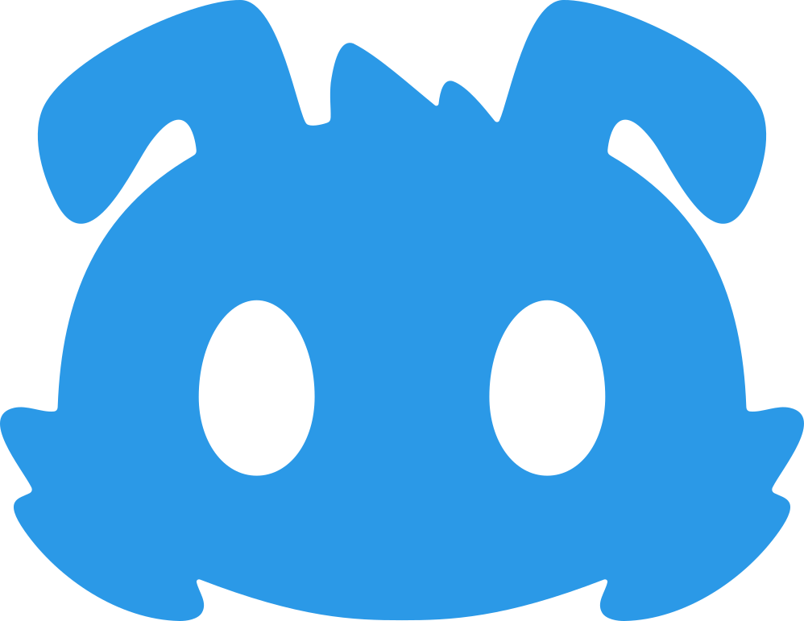

<p align="center">
  
</p>
<h1 align="center">Overcord</h1>
<p align="center"><b>Self-hosted chat and calls for the people you know</b></p>

<p align="center">
  <a href="#-features"><b>Features</b></a> •
  <a href="docs/DEVELOPMENT.md"><b>Development</b></a> •
  <a href="docs/DEPLOY.md"><b>Deployment</b></a> •
  <a href="https://github.com/coelhomarcus/overcord/issues"><b>Issues</b></a>
</p>

<br />

Overcord is a self-hosted place to chat and call with friends. Talk in direct messages, or create private servers with text and voice channels, roles, and invitations. There is no public server directory: people join through a friend or an invite link.

## 🌟 Features

**Chat**
- Direct messages and private servers with text channels, organized into categories.
- Replies, reactions, edits, deletes, mentions (members, roles, `@everyone`, `@here`) and `||spoilers||`.
- Message search with filters for author, channel, content type, mentions and dates. Use Enter to search with your chosen filters, or use the arrow keys and Space to choose a suggestion in the search field.
- Pinned messages per channel and DM, and private saved messages.
- Attachments, voice messages, and link cards with YouTube and Twitch players.
- A video player with keyboard shortcuts and picture-in-picture, and a media viewer with zoom and a thumbnail strip.
- Emojis, GIFs and stickers, plus custom emojis and stickers per server.
- Unread markers that sync across tabs and devices.

**Voice and video**
- Voice channels and one-to-one DM calls, with camera and screen sharing.
- One call per account: every tab and device shows the call you are in, and can take it over after asking.
- A soundboard per server, usable in any call.

**Servers**
- Roles, channel permissions, invite links, kicks, and bans.
- Right-click or long-press a server, category, channel, or member for its actions. The More actions button and Shift+F10 open the same menu. Channels and categories can be edited or deleted by members with permission. Deleting a category moves its channels to the uncategorized list and preserves their permissions.
- Server templates to get started quickly.
- Audit log of moderation and settings changes.
- Webhooks so deploys, monitors, and other services can post into a channel ([guide](docs/WEBHOOK.md)).

**People**
- Friends by exact `@username`, friend requests, and blocking. The friends and direct message lists offer row actions by right-click, long press, or keyboard.
- Presence (available, idle, do not disturb, invisible) and custom statuses.
- Activity: the desktop app shows what you are playing or using on your profile, in member lists and in your friends' Active Now, including what games send through Discord Rich Presence. It can be turned off or limited per game.
- A profile with connected accounts and a Wall of widgets: MyAnimeList, GitHub, games from IGDB, Steam, Twitch, and your own playtime.
- Profile badges for Overcord developers and contributors and for supporters who helped fund the project, granted from the administration site. Clicking a badge lists every badge the account holds.

**Notifications**
- Web Push for messages, mentions, friend requests, and invites, plus an unread badge on the app icon.
- Notification level and mute per server, channel, and DM.

**Account**
- Two-step login by email, sign-in alerts, and a list of active sessions you can end.
- Username and password changes, account deletion, and a download of your data.
- Themes, density, fonts, languages (Portuguese and English) and notification sounds, synced across your devices.
- Installable as a web app (PWA), with share-to-Overcord on Android.
- The web app opens at the root of its domain. Existing `/app` links redirect to their new addresses.

**Administration**
- An optional [administration site](docs/DEPLOY.md#administration-site) with a dedicated hostname and sign-in for managing users and their badges, servers, webhooks, reports, audit history and uploads.
- [Full backups](docs/DEPLOY.md#backups) downloaded from the administration site as one ZIP of the database and every stored file, never kept on the server.

## ⚡ Quick start

Have a PostgreSQL database and a LiveKit server ready, then build Overcord's default image:

```bash
git clone https://github.com/coelhomarcus/overcord.git
cd overcord
cp .env.example .env
docker build -t overcord .
```

Set the database URL, public app URL and LiveKit credentials in `.env`. Set a registration code to let people sign up. Follow the [standalone Docker instructions](docs/DEPLOY.md#the-image-on-its-own) to start the image with persistent uploads, or [deploy on Dokploy](docs/DEPLOY.md#dokploy). For email, push and other settings, copy the entries you need from [`.env.optional.example`](.env.optional.example).

## 🚀 Development

For local development, run the frontend and backend on the host. The [local development guide](docs/DEVELOPMENT.md) shows how to start PostgreSQL, LiveKit and a mail sink with `docker run`.

A Windows desktop app lives in `desktop/`: an Electron window that opens your Overcord server, where `overcord://` links open invites and conversations. See [Desktop app](docs/DEVELOPMENT.md#desktop-app) for running it and [building its installer](docs/DEPLOY.md#desktop-app) for your server.

## 🐳 Deployment

Overcord ships as one image and runs as one service: a single Bun process that serves the app, the administration site, the API and realtime, with PostgreSQL and LiveKit as its only outside dependencies. Run the [standalone image](docs/DEPLOY.md#the-image-on-its-own) behind an HTTPS proxy or [on Dokploy](docs/DEPLOY.md#dokploy). The [deployment guide](docs/DEPLOY.md) also covers environment variables, storage, backups and rollback.

## 🧰 Commands

```bash
bun run dev           # API and web app in watch mode
bun run dev:desktop   # the desktop app against the dev server (npm install --prefix desktop first)
bun run db:seed       # sample accounts, DMs and a server in the local database
bun run backup --out backups/  # the database and every stored file in one ZIP
bun run check         # typecheck, lint, unit tests and production build
bun run test:e2e      # real browsers against a Docker stack (needs Docker and Chrome)
```

Unit tests use Node's test runner (backend) and Vitest with React Testing Library (frontend), and need neither a database nor LiveKit. The end-to-end suite (Playwright) drives several accounts through every feature, a redeploy and an upgrade from the production version. Every script, and what each end-to-end spec covers, is in [docs/DEVELOPMENT.md](docs/DEVELOPMENT.md#scripts).

## 🛠️ Built with

[](https://react.dev/)
[](https://vite.dev/)
[](https://www.typescriptlang.org/)
[](https://tailwindcss.com/)
[](https://bun.com/)
[](https://fastify.dev/)
[](https://orm.drizzle.team/)
[](https://www.postgresql.org/)
[](https://socket.io/)
[](https://livekit.io/)

## 🤝 Contributing

Found a bug or have an idea? [Open an issue](https://github.com/coelhomarcus/overcord/issues). Before opening a pull request, run `bun run check`. See [AGENTS.md](AGENTS.md) for repository conventions.

## License

[MIT](LICENSE)

Emoji pictures are [Twemoji](https://github.com/discord/twemoji) by Twitter, Inc and other contributors, licensed under [CC-BY 4.0](https://creativecommons.org/licenses/by/4.0/).

